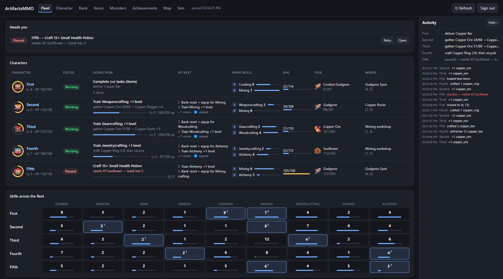
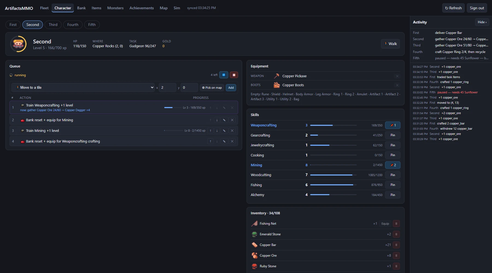
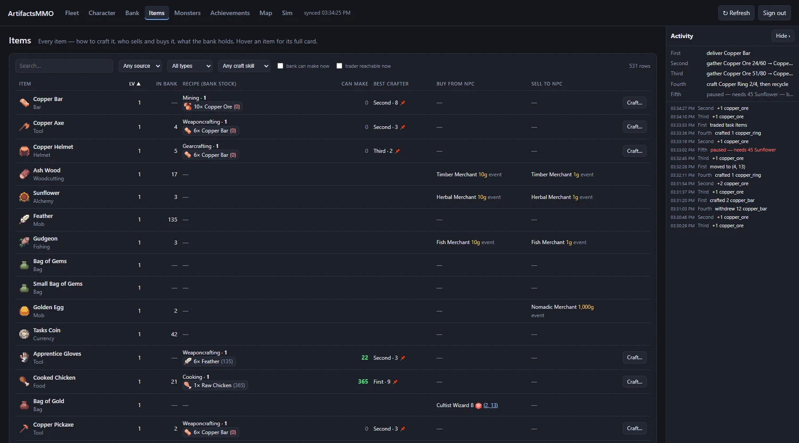
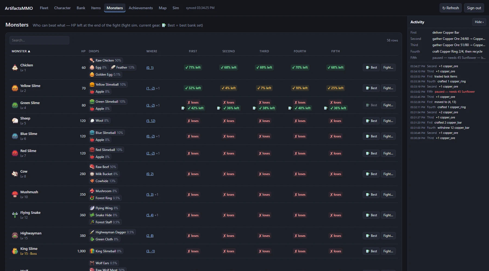
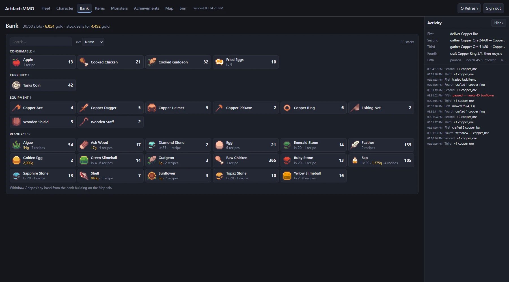

# ArtifactsMMO Client

A small local client for [ArtifactsMMO](https://play.artifactsmmo.com/): a Node
service on your PC plays the game (queues, automation, every API call) and serves
a browser UI that is only a view. It syncs your account's durable state **once**
at start and then keeps it current from action responses — no polling — so it
stays well inside the API rate limits.

The game isn't real-time, so the client is a **table-first check-in console**: the
home screen answers *is everyone working, what's next, what needs me?*, and the
catalog (recipes, shops, monsters, bank) lives in sortable tables.

Built with **TypeScript + Preact** (signals for reactive state); the same engine
code runs in the Node service, the UI is built with Vite.



## Run

```bash
npm install
npm start          # build the UI, run the service (restarted if it ever dies)
npm run dev        # development: Vite HMR inside the service, restarts on engine edits
npm run typecheck  # tsc --noEmit
```

Open <http://localhost:5173/>. Put your API token (from
[artifactsmmo.com](https://artifactsmmo.com/account)) in `.env` as `TOKEN=<your jwt>`
(see `.env.example`; gitignored), or paste it into the token prompt. The service
keeps it and all its state in `.ammo/` (gitignored); the browser holds neither.
The service listens on `127.0.0.1` only.

## Features

Everything lives in tabs — **Fleet · Character · Bank · Items · Monsters ·
Achievements · Map · Sim** — with an always-on activity panel beside them.

- **Fleet** (home) — *Needs you* first (paused queues with Retry, idle characters,
  rewards to claim, live events), then one row per character: status, what it's
  doing with progress, what's next, pinned main skills, bag, task and location; a
  characters × skills grid (click a cell to pin a main skill); and the hive and
  fleet gear coverage as collapsible sections.
- **Activity panel** — on the right of every tab: each character's live status
  and the action feed, newest first. Hide it to a thin edge strip.
- **The action queue** — the automation engine: a per-character, editable list of
  simple actions (move, fight ×N, gather ×N, craft ×N, train a skill, bank moves,
  gear swaps, task loops…), shown as a numbered table on the **Character** tab with
  the runner's live step. A count of 0 means *forever*. Paced by action cooldowns,
  **survives a service restart**, and skips steps whose map target vanished (an event
  that ended) instead of stalling.
- **Skill loops** — pin up to two main skills per character; *Train pins* queues a
  repeating loop that levels them in turn (gathering skills work the best node for
  the level, workshop skills run source → craft → recycle).
- **Bank-centric gear** — the bank is the single source of truth for equipment: a
  gear step dresses the character in the best set available in the bank at that
  moment (fight sets come from a combat-sim solver; fights re-check the bank every
  round and upgrade mid-grind).
- **Items** — the whole catalog in one table: recipe with bank stock per
  ingredient, how many the bank can make, the best crafter, which NPCs sell and
  buy it and whether they're reachable now (event merchants count down). Queue a
  craft for any character straight from the row; hover any item anywhere for its
  full card (stats, recipe, where to get it, prices).
- **Bank** — a compact tile grid grouped by type, sortable by name / quantity /
  value / level, with slots, gold and what the stock would sell for.
- **Monsters** — a fight forecast for every character against every monster (HP
  left at the end), with current gear or — one click — the best set the bank could
  dress them in; queue fights from the row.
- **The hive** (🐝, on Fleet) — an account-level coordinator that puts every
  character on one goal: pick a scored proposal (gear upgrades, task farming,
  achievements, skill leveling) or order your own — *craft me N of X*, or *earn +N
  gold* with each character working its best gold-per-hour lane. It compiles goals
  down to queue items and re-plans at each wave boundary from live state.
- **Fleet gear coverage** (🛡, on Fleet) — can the bank dress everyone? A slots ×
  characters matrix of the best owned set each character would get from shared
  stock, with missing-copy shortages and slots nobody can fill.
- **Achievements** — progress sorted closest-to-done, each objective with where to
  advance it, plus unclaimed rewards to claim.
- **Map** — the canvas world map on its own tab (layers, live event overlays, a
  hover inspector); click a building to craft, trade, use the bank or handle tasks
  by hand. *Walk* and *Pick on map* open a pop-up map from any tab.
- **Fight-sim playground** — plan equipment setups against any monster with the
  deterministic combat simulator; one click loads the whole-catalog best-in-slot
  set or the best set your bank could dress right now.

<p align="center">
  
  
</p>
<p align="center">
  
  
</p>

> Automation runs **in the local service**, not in the browser: close the tab and
> the characters keep working. Open as many tabs as you like — they are views. Only
> one service can run at a time (the second one refuses the port).

## How it works

- **A local service, the browser as a view.** One Node process
  (`src/server/main.ts`) runs every queue and API call; the page gets a state
  snapshot plus live changes over Server-Sent Events (`/events`) and sends edits
  and actions back as `POST /rpc`. `scripts/serve.mjs` restarts the service if it
  ever exits (with a growing delay, so a crash loop can't burn the API budget),
  and it resumes the queues where they stopped.
- **One sync, then no polling.** At start the service restores its saved state, loads the static catalogs from `public/data/*.json` into memory,
  then does a single authoritative read of `/my/characters`, `/my/bank`,
  `/my/bank/items`, active events, unclaimed rewards and account info. After that, every action response carries the
  full authoritative character (and bank item moves echo the bank), so local state
  is updated from responses alone — see `src/state/apply.ts`. Re-sync only happens
  when you click **Refresh**.
- **Rate-limit aware.** The per-account read endpoints are the scarcest budget
  (~300/hr), so we minimize them. `src/api/client.ts` handles cooldown (error 499)
  and rate-limit (429) retries and pagination.

See [CLAUDE.md](CLAUDE.md) for the architecture in more depth.

## Project structure

```
public/data/*.json   bundled snapshot of the game's static catalogs
public/assets/        map tiles + item/character icons (committed, served locally)
src/
  server/     the local service: SSE state stream (/events), /rpc, static UI, Vite in dev
  api/        client (fetch + retry + pagination), typed action calls
  catalog/    load *.json into typed Maps; lookups (item, monster, mapAt, …)
  plan/       pure planning: queue vocabulary, gear/BIS solver, consumables,
              fleet coverage, and the hive goal compiler (plan/hive/)
  sim/        deterministic combat simulator (stats, forecast, Monte Carlo)
  state/      signals store, persistence, the apply chokepoint, boot sync,
              the queue runner + shared execution mechanics, the hive runtime
  ui/         Preact components: one per tab (FleetView, CharacterPanel,
              TableTabs = Bank/Items/Monsters, …), the shared DataTable,
              the activity panel, MapView
  types/      api.ts (dynamic) + catalog.ts (static) domain models
```

## Refreshing the catalog snapshot

`public/data/*.json` is a snapshot of the game's static data (see
`data/manifest.json` for the server version and fetch time). It only needs
refreshing when the season/version changes. Each file mirrors a public,
unauthenticated endpoint (`/items`, `/maps`, `/monsters`, …) paged at `size=100`.
Icons and map tiles under `public/assets/` are (re)downloaded with `npm run assets`.
